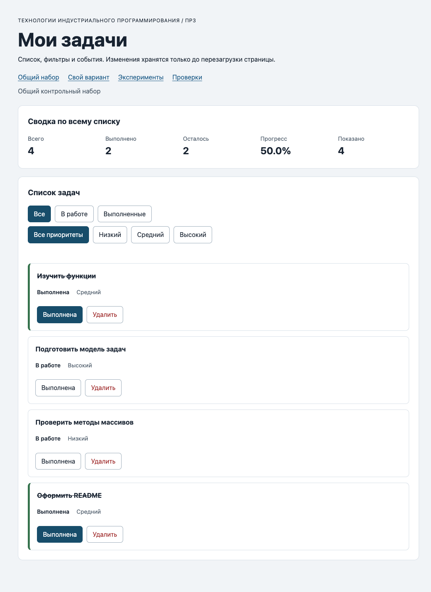

# Практическая работа № 3. Работа с DOM и событиями

## Данные работы

| Поле | Значение |
|---|---|
| Имя | Сидлецкий Владислав Викторович |
| Группа | ЭФБО-05-25 |
| Вариант из ПР2 | 1 — «Подготовка учебного проекта» |
| Node.js | v26.0.0 |
| Браузер | Google Chrome 154.0.8037.98 |
| Операционная система | macOS 26.5 |

## Запуск

Рабочая папка: `practice-03` внутри личного репозитория.

```bash
npm run check:service
npm start
```

Устанавливать зависимости через `npm install` не требуется.

```text
http://127.0.0.1:5503/
http://127.0.0.1:5503/index.html?dataset=variant
http://127.0.0.1:5503/examples/dom-events.html
http://127.0.0.1:5503/checks.html
```

Остановка сервера: `Ctrl+C`.

## Что перенесено из ПР2

`src/task-service.js` и `src/data.js` скопированы без изменений из `practice-02/src` (собственная реализация девяти функций и данные варианта 1). Повторная проверка копии внутри ПР3 — `npm run check:service`: 35 из 35. Исправлений в логике ПР2 не потребовалось.

## Эксперименты

Страница `examples/dom-events.html`; нажатия: «Добавить запись» дважды, затем по вложенному тексту «Изменить заголовок».

| № | До запуска: прогноз | После запуска: результат | Объяснение |
|---:|---|---|---|
| 1. Отсутствующий элемент и коллекция | `null` и длина `0` | `Отсутствующий элемент: null`, `Пустая коллекция: 0` | `querySelector` без совпадений возвращает `null` — у него нельзя читать свойства (будет `TypeError`); `querySelectorAll` всегда возвращает `NodeList`, пустой — длины 0 |
| 2. dataset и числовой id | `"23"` типа `string`, после `Number` — `23` | `dataset.taskId: 23 string`, `Числовой id: 23` | Значения `data-*` всегда строки; `data-task-id` → `dataset.taskId`. Для модели нужен `Number` |
| 3. Статический NodeList | старый 1, новый 2 и 3 | `Старый NodeList: 1` / `Новый querySelectorAll: 2`, затем `1` / `3` | `querySelectorAll` возвращает статический снимок; новые `li` видны только в новом запросе |
| 4. Строка с HTML-разметкой | показывается текст с угловыми скобками | Заголовок: `<strong>Это текст, а не HTML</strong>`; элемента `strong` внутри `h2` нет | `textContent` записывает текст, разметка не разбирается (в отличие от `innerHTML`) |
| 5. Распространение события | захват на карточке → кнопка → всплытие на карточке | `1. phase=1; target=lab-label; currentTarget=lab-card`<br>`2. phase=3; target=lab-label; currentTarget=lab-button`<br>`3. phase=3; target=lab-label; currentTarget=lab-card` | `target` всё время — `span#lab-label`, где был клик; `currentTarget` — элемент, чей обработчик выполняется. Обработчик кнопки сработал в фазе 3 (всплытие), потому что цель — вложенный `span`, а не сама кнопка. Поэтому обработчик контейнера получает клики по вложенным элементам — на этом основано делегирование |

## Организация кода

| Файл | Ответственность |
|---|---|
| `task-service.js` | логика ПР2 без изменений, без `document` |
| `task-selectors.js` | `getVisibleTasks(tasks, filter)` — выборка `all`/`pending`/`completed` через `filter` или копию `[...tasks]`; `filterByPriority` — расширение |
| `task-view.js` | `createTaskElement` (карточка через `createElement` и `textContent`), `renderTaskList` (`replaceChildren(...cards)`), `renderSummary` (через `getTaskStats`), `renderEmptyState` |
| `main.js` | состояние `currentTasks`, `currentFilter`, `currentPriority`; `renderApp`; обработчики `handleTaskListClick`, `handleFilterClick`, `handlePriorityFilterClick` |

- **Полный список** — `currentTasks`, **фильтр** — `currentFilter` (в `main.js`). Видимая выборка вычисляется в `renderApp` и нигде не сохраняется, поэтому фильтр не теряет записи.
- **Событие** обрабатывается делегированно: один обработчик на `ul#task-list`, назначен один раз вне `renderApp`. Кнопка ищется через `closest("button[data-action]")` + `list.contains(button)`.
- **Сводка** вычисляется `getTaskStats(currentTasks)` по полному массиву; «Показано» — длина видимой выборки.

## Общий сценарий

Фактические результаты (headless Chrome, клики по `.action-label` и `.filter-label`, т.е. по вложенным `span`):

| Шаг | Видимые id | Всего | Выполнено | Осталось | Прогресс | Показано | Сообщение | Совпало с ожиданием |
|---:|---|---|---|---|---|---|---|---|
| 0 | `[1, 4, 7, 10]` | 4 | 2 | 2 | 50.0% | 4 | — | Да |
| 1 | `[4, 7]` | 4 | 2 | 2 | 50.0% | 2 | — | Да |
| 2 | `[7]` | 4 | 3 | 1 | 75.0% | 1 | — | Да |
| 3 | `[1, 4, 7, 10]` | 4 | 3 | 1 | 75.0% | 4 | — | Да |
| 4 | `[1, 4, 10]` | 3 | 3 | 0 | 100.0% | 3 | — | Да |
| 5 | `[]` | 3 | 3 | 0 | 100.0% | 0 | «Нет задач по выбранному фильтру.» | Да |
| 6 | `[1, 4, 10]` | 3 | 2 | 1 | 66.7% | 3 | — | Да |
| 7 | `[]` | 0 | 0 | 0 | 0.0% | 0 | «Список задач пуст.» | Да |

После перезагрузки: возвращается шаг 0 (`[1, 4, 7, 10]`, 4 / 2 / 2 / 50.0%) — данные хранятся только в памяти страницы, это ожидаемо для ПР3.

## Индивидуальный вариант

Тема: «Подготовка учебного проекта». Исходные задачи (`src/data.js`): 11 «Выбрать тему проекта» (high), 23 «Составить план работ» (medium), 37 «Подобрать источники» (low), 41 «Написать черновик» (high), 58 «Подготовить презентацию» (medium), 64 «Отрепетировать защиту» (low); все `completed: false`.

| Этап | Всего | Выполнено | Осталось | Прогресс | Видимые id |
|---|---|---|---|---|---|
| До действий | 6 | 0 | 6 | 0.0% | `[11, 23, 37, 41, 58, 64]` («В работе» — те же, «Выполненные» — `[]`, «Нет задач по выбранному фильтру.») |
| После переключения 23 | 6 | 1 | 5 | 16.7% | `[11, 23, 37, 41, 58, 64]` |
| После удаления 37 | 5 | 1 | 4 | 20.0% | `[11, 23, 41, 58, 64]` |
| Итог, фильтр «В работе» | 5 | 1 | 4 | 20.0% | `[11, 41, 58, 64]` |
| Итог, фильтр «Выполненные» | 5 | 1 | 4 | 20.0% | `[23]` |

Итоговый прогресс `20.0%` совпадает с таблицей методички для варианта 1. Приоритеты оставшихся записей сохранены: Высокий, Средний, Высокий, Средний, Низкий.

## Протокол проверки сервиса

`npm run check:service` (06.10.2026, Node.js v26.0.0):

```text
OK: 01. Создание задачи с явным приоритетом
OK: 02. Приоритет по умолчанию
OK: 03. Удаление краевых пробелов без изменения внутренних
OK: 04. Граничные длины названия и положительный безопасный id
OK: 05. Некорректные названия при создании
OK: 06. Некорректные идентификаторы при создании
OK: 07. Все допустимые приоритеты и отклонение недопустимых
OK: 08. Каждый вызов createTask возвращает новый объект
OK: 09. Поиск по id, а не по индексу
OK: 10. Отсутствующая задача и пустой массив при поиске
OK: 11. Поиск не преобразует строковый id в число
OK: 12. Получение невыполненных задач
OK: 13. Пустой список, все выполнены и все не выполнены
OK: 14. Названия в исходном порядке и пустой список
OK: 15. Сводка по общему набору
OK: 16. Сводка по пустому списку
OK: 17. Сводка: ничего не выполнено и выполнено всё
OK: 18. Процент остаётся числом без предварительного округления
OK: 19. Добавление в конец без изменения входного массива
OK: 20. Добавление в пустой список с приоритетом по умолчанию
OK: 21. Повторяющийся id отклоняется
OK: 22. Добавление не обходит проверки createTask
OK: 23. Изменение completed в обе стороны
OK: 24. completed принимает только boolean
OK: 25. Некорректный или отсутствующий id при изменении статуса
OK: 26. Повторная установка статуса создаёт новый результат
OK: 27. Переименование сохраняет остальные поля
OK: 28. Проверки названия при переименовании
OK: 29. Некорректный или отсутствующий id при переименовании
OK: 30. Удаление по id с сохранением порядка
OK: 31. Удаление единственной записи
OK: 32. Некорректный, отсутствующий id и удаление из пустого списка
OK: 33. Входные объекты не изменяются ни одной операцией
OK: 34. Общий сценарий и все промежуточные сводки
OK: 35. Работа с другим набором, без зависимости от demoTasks

Проверок пройдено: 35; не пройдено: 0.
```

## Протокол браузерных проверок

Текст блока «Текстовый протокол» страницы `checks.html` (Chrome 154):

```text
OK: Фильтр all возвращает новый массив в исходном порядке
OK: Фильтр pending выбирает невыполненные задачи
OK: Фильтр completed выбирает выполненные задачи
OK: Все три фильтра работают с пустым списком
OK: Фильтрация не меняет входные записи и их порядок
OK: Карточка — li.task-card с числовым id в dataset
OK: Статус невыполненной карточки и aria-pressed согласованы
OK: Статус выполненной карточки и aria-pressed согласованы
OK: В карточке две обычные кнопки с вложенными подписями
OK: Все приоритеты отображаются по установленному словарю
OK: Название с разметкой отображается текстом
OK: Отрисовка списка создаёт карточки в исходном порядке
OK: Повторная отрисовка не накапливает карточки
OK: Контейнер списка и его обработчик сохраняются
OK: Отрисовка пустого массива очищает прежние карточки
OK: Сводка считается по всему списку, отдельно выводится Показано
OK: Пустая сводка не содержит NaN и Infinity
OK: Сообщение для полностью пустого списка
OK: Сообщение для пустого результата фильтра
OK: Появление карточек скрывает прежнее пустое состояние
OK: Приложение: начальный набор и сводка
OK: Приложение: фильтр срабатывает по клику на вложенный span
OK: Приложение: активный фильтр отмечен классом и aria-pressed
OK: Приложение: фильтрация не удаляет скрытые задачи
OK: Приложение: переключение по id, а не индексу массива
OK: Приложение: выполненная задача исчезает из фильтра В работе
OK: Приложение: удаление изменяет данные, а не только DOM
OK: Приложение: клик по названию не изменяет данные
OK: Приложение: после перерисовок одно нажатие — одно изменение
OK: Приложение: удаление всех записей и нулевая сводка
OK: Приложение: нет совпадений — не то же самое, что нет задач
OK: Приложение: неизвестный числовой id не меняет данные
OK: Приложение: id 4abc не превращается в 4
OK: Приложение: неизвестное действие игнорируется
OK: Приложение: после изменения сохраняется клавиатурный фокус
OK: Приложение: новая загрузка возвращает исходное состояние

Всего: 36. Пройдено: 36. Ошибок: 0.
```

## Собственные проверки

| № | Исходное состояние и действия | Ожидаемый результат | Фактический результат | Итог |
|---:|---|---|---|---|
| 1 | Общий набор; три быстрых нажатия «Выполнена» у `id = 4` (событие) | нечётное число переключений → `4` выполнена; 4 / 3 / 1 / 75.0% | 4 / 3 / 1 / 75.0%, видимые `[1, 4, 7, 10]` | Пройдено |
| 2 | Продолжение №1 (выполнены `1, 4, 10`); фильтр «Выполненные», переключить `id = 1`, затем «В работе» (действие после смены фильтра) | `1` исчезает из «Выполненных»: `[4, 10]`; фильтр остаётся «Выполненные»; в «В работе» — `[1, 7]`; 4 / 2 / 2 / 50.0% | «Выполненные»: `[4, 10]`, 4 / 2 / 2 / 50.0%; «В работе»: `[1, 7]` | Пройдено |
| 3 | Продолжение №2; 5 раз «В работе» ↔ «Все», затем одно нажатие на `id = 7` (повторная отрисовка не накапливает обработчики) | одно нажатие — одно изменение: 4 / 3 / 1 / 75.0% | 4 / 3 / 1 / 75.0% | Пройдено |
| 4 | Удалить `7`, `1`, `10` — осталась одна задача `4`; выполнить её; фильтр «В работе» (граничное состояние) | 1 / 0 / 1 / 0.0% → 1 / 1 / 0 / 100.0% → «Нет задач по выбранному фильтру.» (не «Список задач пуст.») | 1 / 0 / 1 / 0.0% → 1 / 1 / 0 / 100.0% → `[]`, «Нет задач по выбранному фильтру.» | Пройдено |

## Отладка и клавиатура

Точки останова в `src/main.js`: строка 72 (`const rawId = card.dataset.taskId;`) и строка 96 (`currentTasks = result.tasks;`). Действие — нажатие на подпись «Выполнена» у `id = 4`.

```text
Пауза 1: main.js:72
  event.target.className      = "action-label"   (span внутри кнопки)
  event.currentTarget.id      = "task-list"      (обработчик висит на ul)
  action                      = "toggle"
  card.dataset.taskId         = "4", typeof = "string"
  после Step over (строка 74): id = 4, typeof id = "number"
  findTaskById(currentTasks, 4) = {"id":4,"title":"Подготовить модель задач","completed":false,"priority":"high"}
Пауза 2: main.js:96
  result.ok = true
  result.tasks = [ ...id 4 с completed: true... ]
  result.tasks === currentTasks → false   (новый массив)
  старая задача 4 в currentTasks: completed = false (не мутирована)
```

Путь события: клик по `span` → всплытие до `ul#task-list` → `closest("button[data-action]")` → `closest("li[data-task-id]")` → `Number("4")` → проверка `isSafeInteger && > 0` → `setTaskCompleted(currentTasks, 4, !false)` → `result.ok` → `currentTasks = result.tasks` → `renderApp()` → `restoreTaskFocus(4, "toggle")`.

**Отказы** (атрибут карточки изменён вручную, как в Elements):

| Значение `data-task-id` | Сообщение | Данные |
|---|---|---|
| `777` (удалить) | «Задача с id 777 не найдена» | 4 / 2 / 2 / 50.0% без изменений; после «Все» карточки пересоздаются из массива: `[1, 4, 7, 10]`, сообщение очищено |
| `4abc` (переключить) | «Некорректный идентификатор задачи: «4abc»» | без изменений — `Number("4abc")` даёт `NaN`, а не `4` |

**Клавиатура:** все действия — настоящие `<button type="button">`, поэтому Tab переводит фокус, Enter и Space нажимают кнопку (браузер генерирует тот же `click`). После переключения статуса фокус возвращается на кнопку «Выполнена» той же задачи; если карточка исчезла (удаление или задача ушла из фильтра) — на активный фильтр. Это подтверждено проверкой «после изменения сохраняется клавиатурный фокус».

## Вид приложения

Снимок после собственного запуска (общий набор, исходное состояние):



## Дополнительное задание

Выполнен **вариант А — дополнительный фильтр по приоритету**. Группа `#priority-filters` (Все приоритеты / Низкий / Средний / Высокий) размещена отдельно от `#task-filters`. Состояние — `currentPriority` в `main.js`; отбор — `filterByPriority(tasks, priority)` в `task-selectors.js`, применяется после `getVisibleTasks`, т.е. фильтры действуют совместно. Сводка считается по полному массиву, «Показано» — по совместной выборке.

| № | Действия | Ожидаемый результат | Фактический результат | Итог |
|---:|---|---|---|---|
| Р1 | «Высокий», затем «В работе» | `[4]`; Показано 1; общая сводка 4 / 2 / 2 / 50.0% | `[4]`; 4 / 2 / 2 / 50.0% / 1 | Пройдено |
| Р2 | В режиме «В работе» + «Высокий» выполнить `4` | нет совпадений → `[]`, «Нет задач по выбранному фильтру.»; оба фильтра остались активными | `[]`, 4 / 3 / 1 / 75.0% / 0; активные: «В работе», «Высокий» | Пройдено |
| Р3 | «Все» + «Средний», затем «Все приоритеты» | `[1, 10]` → `[1, 4, 7, 10]` | `[1, 10]` → `[1, 4, 7, 10]` | Пройдено |

## Вывод

Логика ПР2 подключена к браузерному интерфейсу без изменений: `task-service.js` не знает о `document`, интерфейс только вызывает его функции и отображает результат. Ключевое различие — **изменение данных и изменение DOM**: удаление карточки через `element.remove()` не удаляет задачу, при следующей отрисовке она вернётся; поэтому любое действие идёт по цепочке «событие → сервис → новый `currentTasks` → `renderApp()`», а DOM всегда строится из массива. Фильтр — это только режим отображения, полный массив не подменяется выборкой. Делегирование событий на `ul` позволяет перерисовывать карточки сколько угодно раз без накопления обработчиков; `closest` делает клик по вложенному `span` рабочим.
