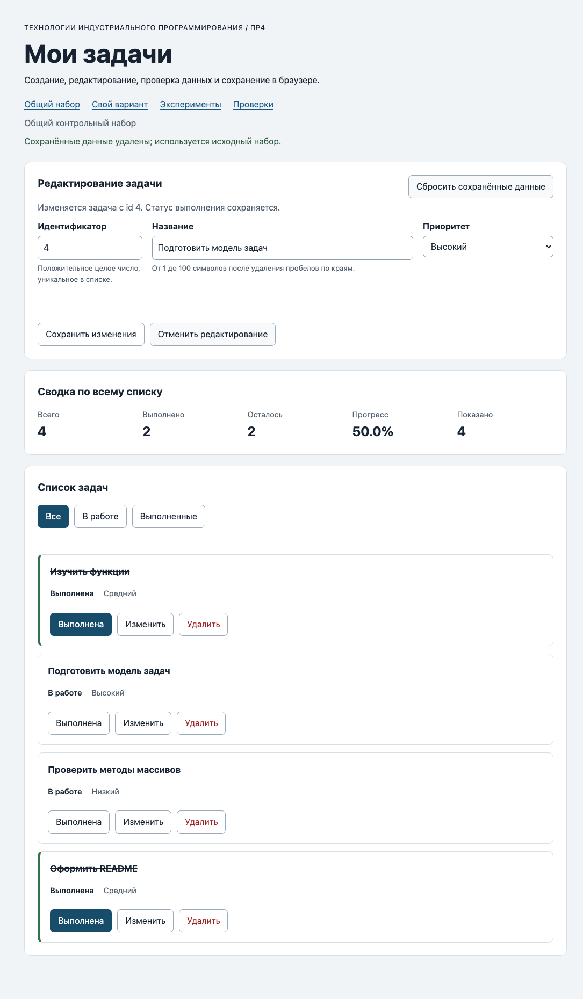
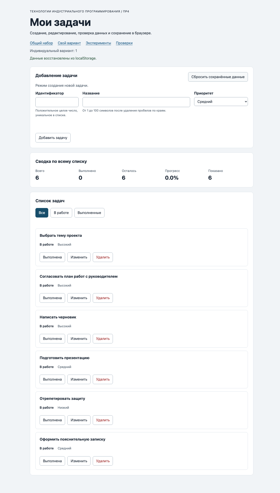

# Практическая работа № 4. Формы, валидация и локальное хранение данных

## Данные работы

| Поле | Значение |
|---|---|
| Имя | Сидлецкий Владислав Викторович |
| Группа | ЭФБО-05-25 |
| Вариант из ПР2–ПР3 | 1 — «Подготовка учебного проекта» |
| Node.js | v26.0.0 (npm 11.12.1) |
| Браузер | Google Chrome 157.0.8103.79 |
| Операционная система | macOS 26.5 |

## Запуск

Рабочая папка: `practice-04` внутри личного репозитория.

```bash
npm test
npm start
```

Устанавливать зависимости через `npm install` не требуется.

```text
http://127.0.0.1:5504/
http://127.0.0.1:5504/index.html?dataset=variant
http://127.0.0.1:5504/examples/forms-storage.html
http://127.0.0.1:5504/checks.html
```

Использовался стандартный порт `5504`. Все проверки выполнялись на одном адресе `127.0.0.1:5504`, потому что `localStorage` привязан к origin.

## Перенос результата ПР3

| Файл | Что перенесено или изменено |
|---|---|
| `data.js` | Скопирован из ПР3 без изменений: общий набор и шесть задач варианта 1. |
| `task-service.js` | Перенесены девять функций ПР2–ПР3; добавлена `updateTask(tasks, id, title, priority)`. |
| `task-selectors.js` | Перенесена `getVisibleTasks` (all / pending / completed). Фильтр по приоритету из доп. задания ПР3 не переносился: в разметке ПР4 его нет. |
| `task-view.js` | Перенесены `createTaskElement`, `renderTaskList`, `renderSummary`, `renderEmptyState`; в карточку добавлена третья кнопка `edit` (`type="button"`, `data-action="edit"`, `span.action-label` «Изменить»). |

`main.js` взят из заготовки ПР4, в него перенесены `renderApp`, `handleFilterClick` и `handleTaskListClick` из ПР3. После переноса `npm run check:service` — 35 из 35, исправлять логику ПР2 не пришлось.

## Эксперименты с формой и хранилищем

Страница `examples/forms-storage.html`, учебный ключ `tip-js-practice-04:lab`.

| № | До запуска: прогноз | После запуска: результат | Объяснение |
|---:|---|---|---|
| 1. Пустое обязательное поле | `submit` не произойдёт, поле невалидно, браузер покажет своё сообщение | Обработчик `submit` не вызвался, журнал остался «Действия ещё не выполнялись.»; `validity.valid = false`, `valueMissing = true`, `validationMessage = "Заполните это поле."` | `required` проверяется браузером до события `submit`: невалидная форма не отправляется, поэтому журнал не меняется. Это не поломка страницы |
| 2. Название из пробелов | `required` пропустит, `submit` произойдёт, прикладная проверка отклонит | До отправки `validity.valid = true`; после — `false`, `customError = true`, сообщение «Название не должно состоять только из пробелов.», журнал: «submit получен, но прикладная проверка отклонила значение.» | Для `required` строка `"   "` непустая. Правило «не только пробелы» — прикладное: `trim()` + `setCustomValidity(message)`. На `input` вызывается `setCustomValidity("")`, иначе поле остаётся невалидным навсегда |
| 3. Типы значений `FormData` | `defaultPrevented: true`, значение — строка, название без краевых пробелов | `submit.defaultPrevented: true`, `typeof FormData title: string`, `typeof localStorage value: string`, `value = {"title":"Учить формы","priority":"high"}` (ввод был `"  Учить формы  "`) | `FormData.get` возвращает строки; числа нужно получать явно через `Number`. `preventDefault` отменяет только отправку документа, обработчик продолжает работу |
| 4. Строка в `localStorage` и JSON | `getItem` вернёт строку JSON, после `JSON.parse` — объект | `raw = "{\"title\":\"Учить формы\",\"priority\":\"high\"}"`, `parsed = { title: "Учить формы", priority: "high" }` | `localStorage` хранит только строки, поэтому запись — `JSON.stringify`, чтение — `JSON.parse` |
| 5. Повреждённый JSON | `JSON.parse` выбросит `SyntaxError`, страница поймает её в `try/catch` | «JSON.parse завершился ошибкой: Expected property name or '}' in JSON at position 1 (line 1 column 2)», `raw = "{broken-json"` | Без `try/catch` исключение прервало бы запуск. Ошибка разбора ≠ ошибка формы: данные уже лежат в хранилище и могли быть изменены вне приложения |

**Итог:** HTML-проверка (`required`, `min`, `step`, `maxlength`) — структура ввода, срабатывает до `submit`; прикладная проверка — правила модели (trim, уникальный id, допустимый приоритет), выполняется в обработчике; ошибка разбора — свойство уже сохранённой строки, её обрабатывает модуль хранения.

## Организация кода

| Файл | Ответственность |
|---|---|
| `task-service.js` | Неизменяющие операции над массивом задач: `createTask`, `addTask`, `setTaskCompleted`, `removeTask`, `updateTask` и др. Без DOM и `localStorage`. |
| `form-validation.js` | Чистая `validateTaskDraft(draft, tasks, editingId)`: `Number` для id с отдельным отказом для пустой строки, уникальность в режиме создания, `editingId` и наличие задачи в режиме редактирования, `trim` и длина 1–100, приоритет из `low/medium/high`. Возвращает все ошибки сразу. |
| `task-storage.js` | Граница `localStorage`: `isValidTaskList`, `loadTasks`, `saveTasks`, `removeSavedTasks`. Оболочка `{ version: 1, tasks }`, все вызовы `getItem/setItem/removeItem` и `JSON.parse` в `try`, результат `{ ok, ... }`. |
| `task-view.js` | Построение карточек (`textContent`), списка (`replaceChildren`), сводки и пустого состояния. |
| `main.js` | Состояние (`currentTasks`, `currentFilter`, `editingId`), `storageKey`, режим формы, обработчики, связь сервиса, хранения и отрисовки. |

- **`storage` передаётся аргументом**, чтобы модуль не зависел скрыто от глобального `window.localStorage`: в Node.js он проверяется объектом `MemoryStorage` и объектами, которые бросают исключения, а зависимость видна в сигнатуре.
- **JSON проверяется до использования**, потому что успешный `JSON.parse` подтверждает только синтаксис. Запись может быть другой версии, с повторяющимися id или с `completed: "нет"`. Такой список отклоняется целиком (`isValidTaskList`), приложение получает копию исходного набора и предупреждение, а повреждённая запись не удаляется автоматически — её можно изучить в DevTools.
- `renderApp` не обращается к storage. Запись выполняет только `persistCurrentTasks` после успешных add / update / toggle / delete.

## Проверка формы

Фактические результаты получены в Chrome на `http://127.0.0.1:5504/` после сброса.

| Сценарий | Ожидаемый результат | Фактический результат | Итог |
|---|---|---|---|
| Добавление корректной задачи | Задача в конце списка, название без краевых пробелов, запись в storage | `20`, `"  Изучить localStorage  "` → карточка «Изучить localStorage», id `[1, 4, 7, 10, 20]`, ключ записан | Пройдено |
| Повторяющийся id | Отказ без изменения списка | Ошибка у поля id «Задача с id 4 уже существует.», `aria-invalid="true"`, список и строка в storage не изменились | Пройдено |
| Пустое название | Отказ | Браузер не отправил форму: `validity.valueMissing = true`, список `[1, 4, 7, 10]`, ключ не создан | Пройдено |
| Название из пробелов | Отказ прикладной проверки | `required` пропустил, `validateTaskDraft` вернул «Введите название: строка из пробелов не подходит.», ключ не создан. После ввода символа ошибка и `aria-invalid` очистились | Пройдено |
| Название длиной 100 | Успех | Задача `30` добавлена, длина названия 100 | Пройдено |
| Название длиной 101 | Отказ | Значение задано скриптом (обходит `maxlength`, `tooLong = false`) — прикладная проверка: «Название не должно быть длиннее 100 символов.», список не изменился | Пройдено |
| Редактирование title и priority | Меняется одна задача, статус сохраняется | id `4`: «Подготовить форму задач», `low`, `completed: false` — остальные задачи и порядок прежние | Пройдено |
| Отмена редактирования | Возврат к пустой форме создания | id разблокирован и пуст, название пустое, кнопка «Добавить задачу», «Отменить» скрыта, фокус в поле id | Пройдено |

## Общий сценарий

| Шаг | Действие | Видимые id | Всего | Выполнено | Осталось | Прогресс | Состояние storage |
|---:|---|---|---:|---:|---:|---:|---|
| 0 | Исходный запуск после сброса | `[1, 4, 7, 10]` | 4 | 2 | 2 | 50.0% | ключа нет |
| 1 | Добавление `id = 20` | `[1, 4, 7, 10, 20]` | 5 | 2 | 3 | 40.0% | запись `1,4,7,10,20` |
| 2 | Отказ для повторного `id = 4` | `[1, 4, 7, 10, 20]` | 5 | 2 | 3 | 40.0% | строка не изменилась; ошибка у поля id |
| 3 | Редактирование `id = 4` | `[1, 4, 7, 10, 20]` | 5 | 2 | 3 | 40.0% | задача 4: «Подготовить форму задач», `low`, `completed: false` |
| 4 | Переключение `id = 7` | `[1, 4, 7, 10, 20]` | 5 | 3 | 2 | 60.0% | запись обновлена |
| 5 | Удаление `id = 1` | `[4, 7, 10, 20]` | 4 | 2 | 2 | 50.0% | запись `4,7,10,20` |
| 6 | Перезагрузка страницы | `[4, 7, 10, 20]` | 4 | 2 | 2 | 50.0% | «Данные восстановлены из localStorage.» |
| 7 | Сброс данных | `[1, 4, 7, 10]` | 4 | 2 | 2 | 50.0% | ключ `tip-js-practice-04:demo` отсутствует |

Все шаги совпали с таблицей методички.

## Проверка восстановления и ошибок

| Случай | Ожидание | Фактический результат | Итог |
|---|---|---|---|
| Записи нет | Используется независимая копия исходного набора | `[1, 4, 7, 10]`, «Используется исходный набор; сохранённых данных пока нет.» | Пройдено |
| Корректная запись | Данные восстанавливаются после перезагрузки | Шаг 6: `[4, 7, 10, 20]`, «Данные восстановлены из localStorage.» | Пройдено |
| Повреждённый JSON | Приложение запускается с исходным набором и предупреждением | В ключ записано `{broken-json` → `[1, 4, 7, 10]`, предупреждение (класс `is-warning`) «Сохранённые данные повреждены (некорректный JSON). Используется исходный набор.»; строка в storage сохранилась до нажатия сброса | Пройдено |
| Неверная версия или схема | Исходный набор и предупреждение | `{ version: 2, tasks: [] }` → «Неподдерживаемая версия сохранённых данных: 2…»; два элемента с `id: 1` → «Сохранённые задачи не прошли проверку схемы…»; в обоих случаях `[1, 4, 7, 10]` | Пройдено |
| Сброс | Удаляется только ключ текущего набора | После сброса `getItem("tip-js-practice-04:demo") === null`; ключ `…:variant` не затронут (используется `removeItem`, не `clear`) | Пройдено |
| Общий и индивидуальный наборы | Изменения не смешиваются | Пока вариант был изменён (`[11, 23, 41, 58, 64, 75]`), общий набор показывал `[1, 4, 7, 10]` и ключ `…:demo` отсутствовал | Пройдено |

## Индивидуальный вариант

Вариант 1 «Подготовка учебного проекта», исходные задачи (все не выполнены):

| id | Название | Приоритет |
|---:|---|---|
| 11 | Выбрать тему проекта | high |
| 23 | Составить план работ | medium |
| 37 | Подобрать источники | low |
| 41 | Написать черновик | high |
| 58 | Подготовить презентацию | medium |
| 64 | Отрепетировать защиту | low |

Действия: добавлена `75` «Оформить пояснительную записку» (`medium`); `23` изменена на «Согласовать план работ с руководителем» (`high`); удалена `37`.

| Этап | Всего | Выполнено | Осталось | Прогресс | Видимые id |
|---|---:|---:|---:|---:|---|
| Исходный набор | 6 | 0 | 6 | 0.0% | `[11, 23, 37, 41, 58, 64]` |
| После добавления `75` | 7 | 0 | 7 | 0.0% | `[11, 23, 37, 41, 58, 64, 75]` |
| После редактирования `23` | 7 | 0 | 7 | 0.0% | `[11, 23, 37, 41, 58, 64, 75]` |
| После удаления `37` | 6 | 0 | 6 | 0.0% | `[11, 23, 41, 58, 64, 75]` |
| После перезагрузки | 6 | 0 | 6 | 0.0% | `[11, 23, 41, 58, 64, 75]` |
| После сброса | 6 | 0 | 6 | 0.0% | `[11, 23, 37, 41, 58, 64]` |

Итог `0.0%` совпадает с таблицей методички для варианта 1. Задача `23` после редактирования: `{ id: 23, title: "Согласовать план работ с руководителем", completed: false, priority: "high" }` — статус не сброшен. Общий набор в это время не изменился.

## Протокол проверок сервиса

```text
OK: 01. Создание задачи с явным приоритетом
OK: 02. Приоритет по умолчанию
OK: 03. Удаление краевых пробелов без изменения внутренних
OK: 04. Граничные длины названия и положительный безопасный id
OK: 05. Некорректные названия при создании
OK: 06. Некорректные идентификаторы при создании
OK: 07. Все допустимые приоритеты и отклонение недопустимых
OK: 08. Каждый вызов createTask возвращает новый объект
OK: 09. Поиск по id, а не по индексу
OK: 10. Отсутствующая задача и пустой массив при поиске
OK: 11. Поиск не преобразует строковый id в число
OK: 12. Получение невыполненных задач
OK: 13. Пустой список, все выполнены и все не выполнены
OK: 14. Названия в исходном порядке и пустой список
OK: 15. Сводка по общему набору
OK: 16. Сводка по пустому списку
OK: 17. Сводка: ничего не выполнено и выполнено всё
OK: 18. Процент остаётся числом без предварительного округления
OK: 19. Добавление в конец без изменения входного массива
OK: 20. Добавление в пустой список с приоритетом по умолчанию
OK: 21. Повторяющийся id отклоняется
OK: 22. Добавление не обходит проверки createTask
OK: 23. Изменение completed в обе стороны
OK: 24. completed принимает только boolean
OK: 25. Некорректный или отсутствующий id при изменении статуса
OK: 26. Повторная установка статуса создаёт новый результат
OK: 27. Переименование сохраняет остальные поля
OK: 28. Проверки названия при переименовании
OK: 29. Некорректный или отсутствующий id при переименовании
OK: 30. Удаление по id с сохранением порядка
OK: 31. Удаление единственной записи
OK: 32. Некорректный, отсутствующий id и удаление из пустого списка
OK: 33. Входные объекты не изменяются ни одной операцией
OK: 34. Общий сценарий и все промежуточные сводки
OK: 35. Работа с другим набором, без зависимости от demoTasks

Проверок пройдено: 35; не пройдено: 0.
```

## Протокол проверок новых модулей

```text
OK: 01. updateTask изменяет название и приоритет выбранной задачи
OK: 02. updateTask нормализует название и сохраняет completed
OK: 03. updateTask не изменяет входной массив и объекты
OK: 04. updateTask отклоняет некорректный и отсутствующий id
OK: 05. updateTask отклоняет некорректные название и приоритет
OK: 06. Валидация создания нормализует поля
OK: 07. Валидация отклоняет некорректные id
OK: 08. Валидация отклоняет повторяющийся id при создании
OK: 09. Валидация проверяет название после trim
OK: 10. Валидация принимает только три приоритета
OK: 11. В режиме редактирования используется editingId
OK: 12. Редактирование отсутствующей задачи отклоняется
OK: 13. Валидация не изменяет draft и список
OK: 14. Проверка схемы принимает корректный список
OK: 15. Проверка схемы отклоняет неверную структуру
OK: 16. Отсутствующая запись возвращает независимую копию исходных данных
OK: 17. Корректная запись восстанавливается из хранилища
OK: 18. Повреждённый JSON приводит к безопасному fallback
OK: 19. Неизвестная версия приводит к безопасному fallback
OK: 20. Некорректные задачи из JSON не принимаются
OK: 21. Ошибка getItem перехватывается
OK: 22. Сохранение записывает версию и задачи
OK: 23. Некорректный список не записывается
OK: 24. Ошибка setItem перехватывается
OK: 25. Удаляется только переданный ключ
OK: 26. Ошибка removeItem перехватывается
OK: 27. Результат загрузки не разделяет объекты с fallback

Проверок пройдено: 27; не пройдено: 0.
```

## Протокол браузерных проверок

Текстовый протокол со страницы `http://127.0.0.1:5504/checks.html` (Chrome 157):

```text
OK: Фильтры ПР3 сохраняют порядок и не изменяют вход
OK: Карточка содержит toggle, edit и delete
OK: Название задачи выводится как текст
OK: Повторная отрисовка списка не накапливает карточки
OK: Сводка использует полный список и отдельный visibleCount
OK: Пустые состояния различают список и фильтр
OK: Приложение запускается с исходным набором
OK: Корректная форма добавляет задачу и сохраняет данные
OK: Повторяющийся id отклоняется без записи
OK: Название из пробелов отклоняется прикладной проверкой
OK: Нативные ограничения не пропускают пустую форму
OK: Кнопка edit заполняет форму и блокирует id
OK: Редактирование меняет title и priority, сохраняя completed
OK: Отмена редактирования возвращает режим создания
OK: Успешная отправка очищает ошибки и форму
OK: Изменение статуса сохраняется
OK: Удаление сохраняется
OK: Фильтр не записывается, но сохраняется после изменения данных
OK: Перезагрузка восстанавливает сохранённые задачи
OK: Сброс удаляет ключ и восстанавливает исходный набор
OK: Повреждённый JSON не ломает запуск
OK: Некорректная схема из storage заменяется исходным набором
OK: Общий и индивидуальный наборы используют разные ключи
Всего: 23. Пройдено: 23. Ошибок: 0.
```

## Собственные проверки

| № | Исходное состояние и действия | Ожидаемый результат | Фактический результат | Итог |
|---:|---|---|---|---|
| 1 | Граница формы: в поле id ввести `0`, название «Ноль», отправить | Нативная проверка `min="1"` блокирует отправку, задача не добавляется | `validity.rangeUnderflow = true`, `submit` не вызван, список не изменился | Пройдено |
| 2 | Восстановление: после сброса отредактировать **выполненную** задачу `1` («  Повторить функции  », `high`), перезагрузить страницу | После перезагрузки: новое название без пробелов, «Высокий», задача по-прежнему выполнена; форма в режиме создания (режим не сохраняется) | «Повторить функции», «Высокий», класс `is-completed`, сводка 4 / 2 / 2 / 50.0%, «Данные восстановлены из localStorage.», заголовок формы «Добавление задачи» | Пройдено |
| 2а | Открыть форму редактирования `10`, затем удалить `10` | Форма возвращается в режим создания, удаление записано в storage | Заголовок «Добавление задачи», id разблокирован; задача 10 удалена из списка и из записи в storage | Пройдено |
| 3 | Исключение хранилища: подменить `Storage.prototype.setItem` на функцию, бросающую `QuotaExceededError`, и переключить `id = 4` | Изменение остаётся в памяти вкладки, пользователь видит предупреждение, исключение не вылетает | Карточка 4 выполнена, сводка 4 / 3 / 1 / 75.0%; статус с `is-warning`: «Не удалось сохранить в localStorage: Квота исчерпана (имитация). После перезагрузки изменения могут быть потеряны.»; ключ не создан | Пройдено |
| 4 | Фильтр «Выполненные» после сброса | Видимые `[1, 10]`, запись в storage не появляется | `[1, 10]`, `getItem` → `null` | Пройдено |

## Отладка и клавиатура

Точки останова в `src/main.js`, функция `handleFormSubmit`: строка 216 (`persistCurrentTasks(...)` — успешный путь) и строка 198 (`showFormErrors(checked.errors)` — отказ).

```text
Успешное добавление (пауза на main.js:216)
  draft     = { id: "20", title: "  Изучить localStorage  ", priority: "high" }   // сырые строки из FormData
  editingId = null
  checked   = { ok: true, value: { id: 20, title: "Изучить localStorage", priority: "high" } }
  result    = { ok: true, tasks: [ 1, 4, 7, 10, { id: 20, title: "Изучить localStorage", completed: false, priority: "high" } ] }
  записанная строка (после Resume):
  {"version":1,"tasks":[{"id":1,"title":"Изучить функции","completed":true,"priority":"medium"},
   {"id":4,"title":"Подготовить модель задач","completed":false,"priority":"high"},
   {"id":7,"title":"Проверить методы массивов","completed":false,"priority":"low"},
   {"id":10,"title":"Оформить README","completed":true,"priority":"medium"},
   {"id":20,"title":"Изучить localStorage","completed":false,"priority":"high"}]}

Повторный id (пауза на main.js:198)
  draft     = { id: "4", title: "Дубликат", priority: "low" }
  checked   = { ok: false, errors: { id: "Задача с id 4 уже существует." } }
  result    — ещё не вычислен (до addTask выполнение не доходит), storage не трогается
```

В режиме редактирования `new FormData(form).get("id")` вернул `null`: поле id имеет `disabled` и не включается в `FormData`, поэтому id берётся из `editingId`.

**Клавиатура.** Все действия — `<button>`, Tab переводит фокус, Enter/Space нажимают кнопку. Нажатие Enter в поле названия отправило форму (задача `21` «Через Enter» добавлена, адрес страницы не изменился — `preventDefault` работает). При начале редактирования фокус переходит в поле «Название», при отмене — в поле «Идентификатор». После `toggle` фокус возвращается на кнопку той же карточки, после `delete` — на активный фильтр («Все»).

## Вид приложения

Режим редактирования задачи `4` (снимок после собственного запуска):



Индивидуальный вариант после добавления, редактирования, удаления и перезагрузки:



## Дополнительное задание

Не выполнено.

## Ответы на контрольные вопросы

1. `submit` срабатывает при любом способе отправки (Enter в поле, кнопка), `click` покрывает только мышь по кнопке.
2. Отменяет действие браузера по умолчанию (отправку и перезагрузку страницы); выполнение обработчика продолжается.
3. Строки (или `File`), для отсутствующего имени — `null`.
4. Disabled-поля не участвуют в отправке и не попадают в `FormData`; поэтому id берётся из `editingId`.
5. HTML: заполненность, `min`, `step`, `maxlength`. Прикладные: `trim`, уникальность id, допустимый приоритет, существование редактируемой задачи.
6. Для `required` строка из пробелов непустая — она не обрезается.
7. `setCustomValidity("")` снимает прикладную ошибку, иначе поле навсегда невалидно; `reportValidity()` проверяет форму и показывает сообщения браузера.
8. Чистую функцию проще тестировать и переиспользовать; DOM — забота `main.js`.
9. По `editingId`: `null` — создание, число — редактирование.
10. Редактирование меняет только название и приоритет; статус — отдельная операция, сбрасывать его — потеря данных.
11. Только строки: объекты сериализуются `JSON.stringify` и разбираются `JSON.parse`.
12. Нет ключа (`getItem` → `null`) — нормальный первый запуск, `source: "initial"`; повреждённая запись — ошибка, fallback и предупреждение.
13. `JSON.parse` проверяет только синтаксис, а не версию, типы полей и уникальность id.
14. Чтобы отличать старые форматы записи и при смене схемы не принять чужие данные.
15. Частично использованный список даст противоречивое состояние; запись либо корректна целиком, либо отклоняется.
16. Явная зависимость: модуль проверяется в Node.js объектом-имитацией и не зависит от глобального `localStorage`.
17. Исключение перехватывается, изменение остаётся в памяти вкладки, пользователь видит предупреждение о возможной потере после перезагрузки.
18. Отрисовка должна быть без побочных эффектов; иначе каждая перерисовка (например, фильтр) писала бы JSON.
19. Это состояние интерфейса, а не данные модели; после перезагрузки приложение открывается в режиме «Все» и создания.
20. Чтобы изменения одного набора не появлялись в другом.
21. Чтобы автоматические проверки не стирали и не портили рабочие данные.
22. `removeItem` удаляет один ключ, `clear()` — все ключи origin, в том числе чужих страниц.
23. `localStorage` привязан к origin (схема + хост + порт); другой порт — другое хранилище.
24. Клавиатура и фокус, индивидуальный вариант, тексты сообщений конкретного браузера, собственные граничные случаи.

## Вывод

Список задач ПР3 дополнен формой создания и редактирования и сохранением в `localStorage`. Логика ПР2–ПР3 перенесена без изменений, добавлена только `updateTask`, которая меняет `title` и `priority` и не трогает `completed`.

Проверка ввода в работе трёхуровневая:
1. **Нативная проверка HTML** (`required`, `min`, `step`, `maxlength`) срабатывает до `submit` и не знает предметной области: строку из пробелов она считает заполненной, а занятость id проверить не может.
2. **Прикладная валидация** (`validateTaskDraft` — чистая функция без DOM) проверяет trim, длину, уникальность id и приоритет и возвращает ошибки по полям. Кроме того, `addTask` и `updateTask` повторно защищают модель независимо от формы.
3. **Проверка данных после чтения из хранилища** (`loadTasks` + `isValidTaskList`) нужна потому, что строку в `localStorage` можно испортить или изменить вне приложения: проверяются синтаксис JSON, версия и полная схема. Некорректная запись не используется частично — приложение запускается с копией исходного набора и предупреждением.
