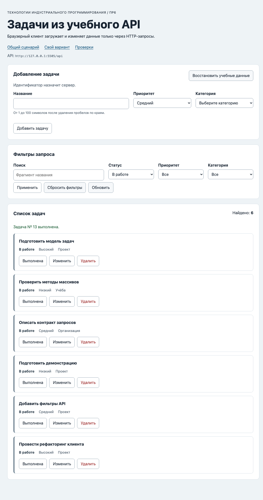
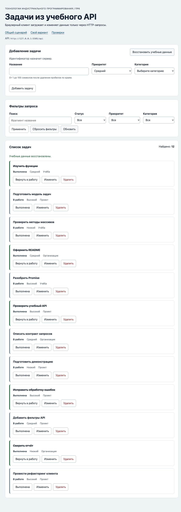

# Отчёт по практической работе № 6

**Тема:** Подключение браузерного приложения к API<br>
**Автор:** Сидлецкий Владислав Викторович<br>
**Группа:** ЭФБО-05-25<br>
**Вариант:** 1

## 1. Цель работы

Связать браузерный интерфейс с HTTP API: перенести клиент ПР5, добавить в него изменяющие методы, разделить код на HTTP-клиент, предметный API, контроллер и DOM-представление, показывать асинхронные состояния `loading` / `ready` / `empty` / `error` и защитить интерфейс от устаревших ответов.

**Результат:** приложение получает категории и задачи из учебного API, отправляет фильтры как query-параметры, создаёт, редактирует, переключает и удаляет задачи через `POST` / `PATCH` / `DELETE` и после каждой мутации заново запрашивает список у сервера. Проходят 70 проверок Node.js и 14 браузерных (в одной браузерной проверке исправлен дефект условия ожидания, см. 5.2).

## 2. Запуск

**Версии:**

```text
node --version: v26.0.0
npm --version:  11.12.1
Браузер:        Google Chrome 157.0.8103.79
ОС:             macOS 26.5
```

**Команда запуска:**

```bash
npm start
```

**Адрес приложения:** `http://127.0.0.1:5506/`<br>
**Индивидуальный вариант:** `http://127.0.0.1:5506/?dataset=variant`<br>
**Адрес API:** `http://127.0.0.1:5505/api`<br>
**Браузерные проверки:** `http://127.0.0.1:5506/checks.html`

Использовались стандартные порты. Для проверки «API не запущен» приложение открывалось с параметром `?api=http://127.0.0.1:5525/api`, а затем на этом порту запускался второй экземпляр API (`node api/server.mjs 5525`).

## 3. Реализация

### 3.1. HTTP-клиент

`src/api-client.js` — решение ПР5, в котором `requestJson(path, { method, query, body, signal, timeoutMs })` расширен так:

- допускаются только `GET`, `POST`, `PATCH`, `DELETE`; метод приводится к верхнему регистру (`"patch"` → `PATCH`), остальные методы дают `TypeError` до сетевого запроса;
- `GET` с `body` отклоняется до запроса;
- к каждому запросу добавляется `Accept: application/json`; `Content-Type: application/json` и `JSON.stringify(body)` — **только** при наличии тела (иначе лишний заголовок неверно описывает запрос и вызывает лишний CORS preflight);
- `fetch` обёрнут в отдельный `try`: отказ классифицируется как `aborted` (внешний сигнал), `timeout` (`AbortSignal.timeout`, сигналы объединены `AbortSignal.any`) или `network`;
- далее порядок: `response instanceof Response` → `!response.ok` → `ApiError` вида `http` со `status`, `code`, `details`, `url` (статус важнее формата тела) → `204` → `null` без чтения тела → проверка `Content-Type` → `response.json()` в `try` (`invalid-response` при ошибке).

### 3.2. Доменный API

`src/task-api.js` (без DOM и пользовательских сообщений):

| Операция | Запрос | Проверка ответа |
|---|---|---|
| `getTasks(filters, { signal })` | `GET /tasks?…` | коллекция задач: схема, уникальные id, `meta.total === data.length` |
| `getTaskById(id)` | `GET /tasks/:id` | `isTask(data)` |
| `getCategories()` | `GET /categories` | коллекция категорий |
| `loadInitialData(filters, { signal })` | два GET через `Promise.all` | обе проверки |
| `createTask(draft)` | `POST /tasks`, тело `{ title, priority, categoryId }` | `isTask(data)` |
| `updateTask(id, changes)` | `PATCH /tasks/:id` (только `title`, `priority`, `categoryId`, `completed`) | `isTask(data)` |
| `setTaskCompleted(id, completed)` | `PATCH /tasks/:id`, тело `{ completed }` | `isTask(data)` |
| `deleteTask(id)` | `DELETE /tasks/:id` | строго `null`, иначе `invalid-response` |
| `resetDemoData()` | `POST /debug/reset` без тела | `{ reset: true, total: целое }` |

До запроса проверяются только id (положительное целое) и фильтры. Поля создаваемой задачи клиентский API не проверяет — это делает форма, а затем независимо сервер (интеграционная проверка 09: `400 VALIDATION_ERROR` с деталями по трём полям).

`src/form-validation.js` — `validateTaskDraft(draft, categories)`: `trim` и длина 1–100, приоритет из трёх значений, `categoryId` из строки select → число, обязательно присутствующее в загруженных категориях. Возвращает `{ valid, value, errors }`, DOM не читает.

`src/task-view.js` — `li.task-card[data-task-id]`, класс `is-completed`, `.task-title`, `.task-meta` со статусом, локализованным приоритетом и `.task-category`, три кнопки `toggle` / `edit` / `delete` с `span.action-label`. Все строки — через `textContent`; `renderTaskList` использует `replaceChildren`.

### 3.3. Состояния интерфейса

```text
start/applyFilters/refresh
        │
        ▼
   loading (aria-busy="true", список скрыт)
        │
   ┌────┼──────────────┬───────────────────┐
   ▼    ▼              ▼                   ▼
 ready  empty        error               aborted
(есть   (успех,      (сообщение по       (более новая загрузка
задачи) 0 задач)     виду ошибки +       или destroy — ничего
                     «Повторить»)        не показывается)
```

- `ready` и `empty` различаются только количеством задач в успешном ответе; при `empty` список скрыт и очищен, «Найдено: 0».
- `error` выводит текст `messageForError` (например, «Нет соединения с учебным API. Проверьте, запущен ли npm start.»), показывает кнопку повтора.
- Пока категории не получены (`categories === null`), любая загрузка, включая повтор, выполняет `loadInitialData`; после этого — только `getTasks` с текущими фильтрами.

### 3.4. Изменение данных

Все мутации идут через одну внутреннюю функцию `runMutation`:

```text
setMutationPending(true) → api.мутация → (сброс формы) → notify(success)
  → повторный GET с текущими фильтрами → отрисовка → finally: setMutationPending(false)
при ошибке: notify(messageForError(error), "error"); для 400 VALIDATION_ERROR
            ошибки details дополнительно показываются у полей формы
```

- **создание** — `submit` в режиме `editingId === null` → `createTask(value)`; id и `completed` назначает сервер;
- **редактирование** — `beginEdit(id)` берёт задачу из последнего ответа, `setFormTask(task)`; `submit` → `updateTask(id, { title, priority, categoryId })` — `completed` в PATCH не передаётся и не меняется;
- **статус** — `setTaskCompleted(id, !task.completed)`;
- **удаление** — после `confirm` в `dom-app.js`; если удалена редактируемая задача, форма возвращается в режим создания;
- **reset** — `resetDemoData()` и перезагрузка текущего фильтра.

Флаг `mutationPending` дополнительно отсекает повторный запуск мутации, пока не завершилась предыдущая. `localStorage` не используется: массив в контроллере — лишь снимок последнего ответа.

### 3.5. Защита от устаревшего ответа

1. Перед каждой загрузкой предыдущий `AbortController` вызывает `abort()`; его `signal` передаётся в `getTasks` / `loadInitialData` → `requestJson` → `fetch`.
2. Каждая загрузка получает номер `++loadSequence`. После `await` результат (и ошибка) применяются только если номер совпадает с последним.

Второй механизм нужен, потому что источник может завершить операцию, не отреагировав на сигнал (кэш, тестовый двойник — так устроена модульная проверка 27). Ошибка `aborted` пользователю не показывается: это ожидаемое следствие смены фильтра.

Наблюдение в Chrome с задержкой сети 600 мс (эмуляция через DevTools Protocol): два быстрых применения фильтра `priority=high` → `priority=low`. В Network: `GET /api/tasks?priority=high` — **canceled**, `GET /api/tasks?priority=low` — 200. На экране только задачи «Низкий» (`[1, 22, 31]`), сообщения об ошибке нет. Во время загрузки `aria-busy="true"`, состояние `loading`.

## 4. Индивидуальный вариант

**Начальный фильтр:** `completed=false` (вариант 1)<br>
**Индивидуальный сценарий:** завершить видимую задачу; после повторного GET она исчезает из выборки.

| Шаг | Ожидаемый результат | Фактический результат |
|---|---|---|
| Открыть `/?dataset=variant` после reset | Фильтр «Статус: В работе», запросы `GET /tasks?completed=false` и `GET /categories` параллельно, 7 задач | `filter-completed = "false"`; запросы `GET /api/tasks?completed=false` (200) и `GET /api/categories` (200); id `[4, 7, 13, 19, 22, 28, 34]`, «Найдено: 7» |
| Нажать «Выполнена» у задачи `13` «Разобрать Promise» | `PATCH /tasks/13`, затем повторный GET с тем же фильтром; задача 13 исчезает | `PATCH /api/tasks/13` (200) → `GET /api/tasks?completed=false` (200); id `[4, 7, 19, 22, 28, 34]`, «Найдено: 6», сообщение «Задача № 13 выполнена.» |
| Проверить сервер | `GET /tasks/13` → `completed: true` | `{ id: 13, title: "Разобрать Promise", completed: true, priority: "high", categoryId: 1 }` |

Задача исчезла не из-за локального удаления карточки, а потому что новый серверный ответ на `completed=false` её уже не содержит.



## 5. Результаты проверок

### 5.1. Автоматизированные проверки Node.js

`npm test`:

```text
OK: 01. health возвращает JSON и заголовки CORS
OK: 02. исходный список содержит 12 задач в контрольном порядке
OK: 03. фильтры и поиск применяются совместно
OK: 04. неверный или повторяющийся query даёт 400
OK: 05. POST создаёт задачу, обрезает title и назначает id
OK: 06. созданная задача доступна по id и в списке
OK: 07. POST требует application/json
OK: 08. повреждённый JSON даёт структурированную ошибку
OK: 09. серверная валидация сообщает ошибки полей
OK: 10. PATCH изменяет только переданные поля
OK: 11. PATCH изменяет completed логическим значением
OK: 12. пустой PATCH и неизвестное поле отклоняются
OK: 13. DELETE возвращает 204 без тела
OK: 14. отсутствующая задача даёт 404 для PATCH и DELETE
OK: 15. неверный id даёт 400
OK: 16. категории доступны отдельным ресурсом
OK: 17. HEAD возвращает заголовки без тела
OK: 18. OPTIONS объявляет CORS для изменяющих методов
OK: 19. неподдерживаемый метод даёт 405 и Allow
OK: 20. отладочные маршруты воспроизводят виды ошибок
OK: 21. слишком большое тело запроса отклоняется
OK: 22. reset восстанавливает данные и счётчик id
OK: 23. два экземпляра API не делят изменяемое состояние

Итог API: успешно 23, ошибок 0.

OK: 01. buildUrl соединяет baseUrl, путь и кодированный query
OK: 02. buildUrl не изменяет объект query
OK: 03. createApiClient проверяет конфигурацию
OK: 04. GET отправляет Accept, query и AbortSignal
OK: 05. POST сериализует тело и добавляет Content-Type
OK: 06. PATCH поддерживается, а неизвестный метод и body у GET отклоняются
OK: 07. успешный 204 преобразуется в null
OK: 08. JSON-ошибка HTTP сохраняет поля контракта
OK: 09. HTTP-ошибка важнее неверного Content-Type
OK: 10. неверный Content-Type и повреждённый JSON отклоняются
OK: 11. сетевая ошибка сохраняется как cause
OK: 12. тайм-аут отличается от внешней отмены
OK: 13. createTaskApi требует requestJson
OK: 14. getTasks нормализует фильтры и проверяет ответ
OK: 15. getTasks отклоняет неверные фильтры до запроса
OK: 16. loadInitialData параллельно запрашивает задачи и категории
OK: 17. createTask отправляет POST и проверяет задачу
OK: 18. update и смена статуса отправляют PATCH
OK: 19. deleteTask требует ответ 204, reset проверяет подтверждение
OK: 20. доменный API отклоняет неверную схему ответа
OK: 21. validateTaskDraft нормализует корректные данные
OK: 22. validateTaskDraft возвращает ошибки каждого поля
OK: 23. контроллер проверяет зависимости
OK: 24. start отображает loading, категории, задачи и ready
OK: 25. пустой ответ отображает состояние empty
OK: 26. ошибка загрузки отображается, а aborted не показывается
OK: 27. новая загрузка отменяет предыдущую и игнорирует устаревший ответ
OK: 28. невалидная форма не вызывает API
OK: 29. создание блокирует действия, очищает форму и обновляет список
OK: 30. редактирование, toggle и delete используют id текущей задачи
OK: 31. ошибка мутации показывается и снимает блокировку
OK: 32. reset вызывает сервер и перезагружает текущий фильтр
OK: 33. messageForError не раскрывает внутреннюю ошибку

Итог модулей: успешно 33, ошибок 0.

OK: 01. начальная загрузка получает задачи и категории
OK: 02. клиент создаёт задачу и получает назначенный id
OK: 03. созданная задача читается по id
OK: 04. редактирование сохраняется на сервере
OK: 05. созданная задача находится серверным поиском
OK: 06. смена статуса видна через фильтр
OK: 07. DELETE удаляет запись и возвращает null
OK: 08. повторное удаление сохраняет код и детали 404
OK: 09. серверная ошибка валидации доступна клиенту
OK: 10. 204 не вызывает ошибку разбора JSON
OK: 11. реальная задержка прерывается по тайм-ауту
OK: 12. внешний AbortController отменяет реальный запрос
OK: 13. повреждённый JSON и text/plain определяются как invalid-response
OK: 14. reset восстанавливает исходный набор

Итог интеграции: успешно 14, ошибок 0.
```

Поиск заглушек `grep -rn "TODO\|Не реализовано" src` — совпадений нет.

### 5.2. Браузерные проверки

Протокол `http://127.0.0.1:5506/checks.html` (Chrome 157):

```text
OK: Карточка содержит безопасный текст и три действия
OK: Повторная отрисовка списка не накапливает карточки
OK: Начальная загрузка показывает 12 задач и 3 категории
OK: Фильтры формируют новый серверный запрос
OK: Поиск без результатов показывает empty, а сброс возвращает список
OK: Корректная форма создаёт задачу с серверным id
OK: Ошибки формы не отправляют запрос и связаны с полями
OK: Редактирование заполняет форму и сохраняет изменения
OK: Отмена редактирования возвращает режим создания
OK: Смена статуса подтверждается сервером
OK: Удаление подтверждается и сохраняется на сервере
OK: Сброс восстанавливает учебный набор
OK: Недоступный API показывает error и кнопку повтора
OK: Приложение не использует localStorage как источник данных
Всего: 14. Пройдено: 14. Ошибок: 0.
```

**Исправление в `checks/browser.checks.js`.** При первом прогоне сценарий «Корректная форма создаёт задачу с серверным id» завершился `FAIL — Не найден элемент: [data-task-id="35"]`, остальные 13 прошли. Причина — в самой проверке: условие ожидания было записано как `waitFor(() => requireNode(doc, '[data-task-id="35"]'))`. `requireNode` **бросает исключение**, если элемента нет, а `waitFor` исключения не перехватывает, поэтому проверка падала на первом же опросе — синхронно, сразу после `requestSubmit()`, до ответа сервера на `POST`. Пройти такое условие могло бы только оптимистическое обновление, а оно в ПР6 запрещено.

Перед исправлением сценарий был выполнен вручную: через 26 мс появилась карточка `35` «Подключить браузер» (без краевых пробелов), поле названия очистилось, «Найдено: 13», сообщение «Задача создана.». Затем в строке 182 условие заменено на неисключающее, как в остальных сценариях:

```diff
- await waitFor(() => requireNode(doc, '[data-task-id="35"]'), "Задача не появилась");
+ await waitFor(() => doc.querySelector('[data-task-id="35"]'), "Задача не появилась");
```

Ожидания проверки (id 35, название, очистка формы, «Найдено: 13») не изменились — исправлено только ожидание ответа.

### 5.3. Ручные проверки

Выполнены в Chrome 157; запросы фиксировались по вкладке Network (через DevTools Protocol).

| Сценарий | Ожидаемый результат | Фактический результат |
|---|---|---|
| API не запущен | Состояние ошибки и кнопка повтора | `?api=http://127.0.0.1:5525/api`: `list-state = error`, «Нет соединения с учебным API. Проверьте, запущен ли npm start.», кнопка «Повторить загрузку» видна, `aria-busy="false"` |
| Повтор после запуска API | Повтор снова выполняет начальную загрузку | Запущен `node api/server.mjs 5525`, нажата «Повторить загрузку» → `ready`, 12 задач, категории появились в форме, кнопка повтора скрыта |
| Пустая выборка | Сообщение empty, список без старых карточек | Поиск «такой задачи точно нет»: `empty`, «По выбранным условиям задач нет.», «Найдено: 0», `#task-list` скрыт и пуст; «Сбросить фильтры» вернул 12 задач |
| Ошибка формы | Запрос не отправляется, поля получают сообщения | Название «   », категория не выбрана: «Введите название: строка из пробелов не подходит.», «Выберите категорию.», `aria-invalid="true"`, «Исправьте ошибки в форме.»; в Network запросов к API нет |
| Создание и обновление страницы | Созданная задача остаётся на сервере | `POST /api/tasks` → 201, затем `GET /api/tasks` → 200; задача `35` «Подключить браузерный клиент». После перезагрузки страницы она на месте, «Найдено: 13» |
| Редактирование с сохранением `completed` | Меняются только title/priority/category | Задача `1` (выполнена) → «Повторить функции», «Низкий»: `PATCH /api/tasks/1` → 200, затем GET; карточка осталась `is-completed`, сервер: `completed: true` |
| Смена статуса при активном фильтре | После GET задача уходит из выборки | Фильтр «В работе»; «Выполнена» у `4`: во время запроса кнопки заблокированы; `PATCH /api/tasks/4` → `GET /api/tasks?completed=false`; `4` исчезла, «Найдено: 7» |
| Отмена подтверждения удаления | Ничего не происходит | `confirm → false`: запросов нет, список не изменился. При `confirm → true`: задача 7 удалена, `GET /api/tasks/7` → 404 |
| Двойное быстрое применение фильтров | Отображается результат последнего запроса | Задержка сети 600 мс; `priority=high` → `priority=low`: первый запрос **canceled**, второй 200; показаны только задачи «Низкий» `[1, 22, 31]`, ошибки нет |
| Безопасный вывод | Разметка из названия не исполняется | Задача с названием ` & API` отображается текстом, `children.length = 0`, элементов `img` в списке нет |
| Восстановление кнопкой reset | Исходный набор | `POST /api/debug/reset` → 200, затем `GET /api/tasks`; 12 задач, задача 7 снова есть, «Учебные данные восстановлены.» |
| Перезапуск API | Восстанавливается исходный набор | Создана задача `35` («До перезапуска»), список из 13 id; после перезапуска `npm start` `GET /api/tasks` вернул исходные 12 id — данные сервера хранятся только в памяти |

**Клавиатура.** Все действия — `<button>`, формы отправляются Enter. При блокировке во время мутации кнопки получают `disabled`, после `finally` разблокируются.



## 6. Ответы на контрольные вопросы

1. **Почему `fetch` обычно не отклоняет Promise при 404 или 500?** Сервер доступен и прислал корректный HTTP-ответ — с точки зрения сети запрос выполнен. Promise отклоняется только при отсутствии ответа (сеть, CORS, отмена). Ошибку уровня приложения нужно определять по `response.ok` / `status`.
2. **Порядок проверок.** `response.ok` → статус `204` → `Content-Type` → `response.json()`. Статус первым, чтобы HTML-страница прокси с `502` не превратилась в «неверный Content-Type»; `204` до `Content-Type`, потому что тела нет.
3. **`POST` и `PATCH`.** `POST /tasks` создаёт новый ресурс: тело `{ title, priority, categoryId }`, id и `completed` назначает сервер, ответ `201`. `PATCH /tasks/:id` частично изменяет существующую задачу: передаются только изменяемые поля, ответ `200`.
4. **`201` и `Location`.** Статус явно сообщает, что ресурс создан, а `Location` — его адрес (`/api/tasks/35`), чтобы клиент мог обратиться к новой записи.
5. **Почему не `response.json()` у `204`.** Тела нет; разбор пустой строки бросает `SyntaxError`. Клиент возвращает `null` до чтения.
6. **CORS preflight и `no-cors`.** Браузер отправляет `OPTIONS` перед запросом с другого origin, если метод не простой (`PATCH`, `DELETE`) или есть заголовки вроде `Content-Type: application/json`. `no-cors` не разрешает доступ, а делает ответ непрозрачным — JSON прочитать нельзя. Решение — заголовки `Access-Control-Allow-*` на сервере.
7. **`empty` и `error`.** `empty` — запрос успешен, данных 0: нормальный результат, без кнопки повтора. `error` — данные не получены (сеть, тайм-аут, ошибка сервера): сообщение о причине и «Повторить загрузку».
8. **Почему не `localStorage`.** Источник истины — сервер: данные общие, проверяются им и меняются через API. Локальная копия устарела бы и расходилась с сервером.
9. **Зачем повторный GET после мутации.** Интерфейс показывает только подтверждённое сервером состояние с учётом текущих фильтров (задача после смены статуса может выпасть из выборки), включая изменения, сделанные сервером (trim, id, `completed`).
10. **Как возникает гонка.** Два запроса выполняются параллельно; первый (старый фильтр) может ответить позже второго и перезаписать новый результат.
11. **Почему одного `AbortController` мало.** Отмена — просьба: источник может её проигнорировать или уже вернуть результат (кэш, двойник, ответ, пришедший в момент отмены). Номер запроса гарантирует, что применится только результат последнего.
12. **Почему отмена не ошибка.** Её инициирует само приложение при смене фильтра или уходе со страницы — это штатное управление потоком, пользователю нечего исправлять.
13. **Клиент и сервер.** Клиент проверяет форму для быстрой обратной связи (trim, длина, приоритет, существующая категория) и схему ответов. Сервер обязан проверять всё заново, потому что клиент можно обойти (curl, DevTools).
14. **Зачем `view` параметром.** Контроллер не зависит от `document`: в Node.js его проверяют с двойником представления, а `dom-app.js` подставляется только в браузере.
15. **Почему `textContent`.** Название приходит с сервера и недоверенно; `innerHTML` разобрал бы его как разметку и мог исполнить код (``). `textContent` выводит текст буквально.

## 7. Вывод

Браузерный интерфейс, клиентский модуль и контракт API связаны цепочкой: `dom-app.js` превращает события в вызовы контроллера → контроллер управляет состоянием и вызывает `task-api.js` → предметный API выбирает путь, метод и тело и проверяет схему ответа → `api-client.js` выполняет HTTP, различает `http` / `network` / `invalid-response` / `timeout` / `aborted` и возвращает `null` для `204`. Сервер остаётся единственным источником данных: после каждой мутации список запрашивается заново с текущими фильтрами, а устаревшие ответы отсекаются отменой и номером запроса.

Найденная проблема — дефект браузерной проверки «Корректная форма создаёт задачу с серверным id»: условие ожидания бросало исключение до ответа сервера. Поведение сначала подтверждено вручную, затем условие ожидания исправлено (ожидаемые значения не менялись) — 14 из 14.

## Дополнительное задание

Не выполнено.
